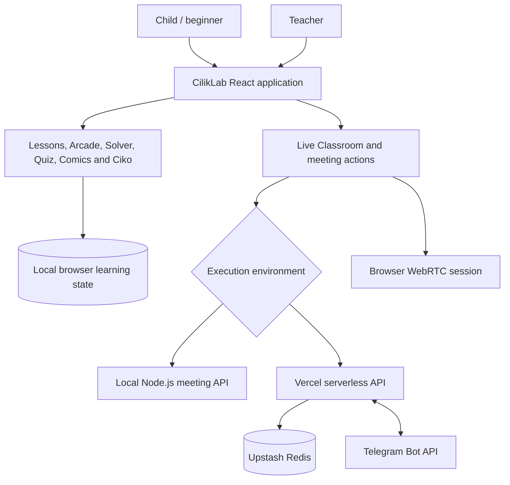

# CilikLab — Little Learners’ Lab

**An interactive, multilingual coding education platform for young learners, beginner programmers, and educators.**

[](https://github.com/chitko84/cilik_lab)


**Repository:** [github.com/chitko84/cilik_lab](https://github.com/chitko84/cilik_lab)  
**Documented release:** v37 — 29 October 2026  
**Project classification:** Interactive educational software / learning technology  
**Current maturity:** Feature-rich demonstrable prototype; not a production-ready school management or child-safety platform

---

## Contents

1. [Executive Summary](#1-executive-summary)
2. [Educational Problem and Project Objectives](#2-educational-problem-and-project-objectives)
3. [Platform at a Glance](#3-platform-at-a-glance)
4. [Learning Experience and Core Features](#4-learning-experience-and-core-features)
5. [Teacher and Classroom Experience](#5-teacher-and-classroom-experience)
6. [Multilingual Learning and Accessibility](#6-multilingual-learning-and-accessibility)
7. [Live Classroom and Telegram Integration](#7-live-classroom-and-telegram-integration)
8. [System Architecture and Technology](#8-system-architecture-and-technology)
9. [Installation and Local Development](#9-installation-and-local-development)
10. [Environment Configuration](#10-environment-configuration)
11. [GitHub and Vercel Deployment](#11-github-and-vercel-deployment)
12. [Testing, Verification, and Quality Assurance](#12-testing-verification-and-quality-assurance)
13. [Demonstration and Evaluation Guide](#13-demonstration-and-evaluation-guide)
14. [Limitations, Privacy, and Responsible Use](#14-limitations-privacy-and-responsible-use)
15. [Development Milestones and Future Work](#15-development-milestones-and-future-work)
16. [Repository Maintenance and Acknowledgements](#16-repository-maintenance-and-acknowledgements)

---

## 1. Executive Summary

CilikLab (Little Learners’ Lab) is a browser-based educational platform designed to make introductory programming more approachable, engaging, and understandable for children and first-time coders. It combines guided learning, interactive programming exercises, coding games, a child-friendly helper called **Ciko**, quizzes, comics, and educator-facing tools in a single experience.

Rather than presenting coding as a sequence of abstract commands alone, CilikLab uses a recurring learning cycle:

**Explore → Try → Improve**

Learners encounter a concept through an explanation, visual example, game, or story; practise it through hands-on tasks; and improve through feedback, debugging hints, or teacher guidance. Educators can inspect the practice information available within the prototype, prepare classes and exercises, and organise support around common learning difficulties.

The latest documented release, **v37**, extends the existing platform with a clearer homepage introduction for children and teachers while preserving the v36 learning content and the Vercel-compatible Telegram meeting backend. The project is intended as a functional prototype and demonstration of an integrated learning experience. Features requiring external deployment, third-party services, or verified user identity must not be interpreted as operational merely because their application code is present.

### Intended users

| User group | Primary need | CilikLab response |
| --- | --- | --- |
| Young learners | A welcoming first encounter with coding | Visual lessons, coding games, comics, quizzes, spoken assistance |
| Beginning programmers | Safe, incremental programming practice | Guided Python-style workspace, daily problems, test feedback and debugging support |
| Teachers and facilitators | Visibility into learning progress and recurring mistakes | Class/exercise management, learner views, help requests, feedback and analytics |
| Project evaluators | A demonstrable end-to-end educational concept | Student and teacher workflows, learning content, multilingual interfaces and optional meeting integration |

## 2. Educational Problem and Project Objectives

### Context

For many beginners, especially younger learners, introductory programming presents several simultaneous difficulties: unfamiliar syntax, abstract logic, fear of making mistakes, and limited access to explanations suited to their age or language. Traditional text-heavy activities can make it hard to connect an instruction with its effect on a program.

### Objectives

CilikLab was designed to:

1. **Reduce entry barriers** through a friendly visual interface and small, progressive learning activities.
2. **Teach computational thinking** through patterns, sequences, conditions, variables, loops, debugging, and problem solving.
3. **Make code behaviour observable** with test outputs, visual tracing, explanatory errors, and guided hints.
4. **Encourage consistent practice** with challenges, levels, progress indicators, and achievement-oriented learning.
5. **Assist educators** through class oversight, structured feedback, and support workflows.
6. **Broaden accessibility** through language selection, responsive layouts, reading support, and browser speech features.
7. **Demonstrate connected instruction** through optional Telegram meeting invitations and browser-based classroom sessions.

These are design objectives, not claims of independently measured learning outcomes. Classroom efficacy and accessibility would require additional user research and formal evaluation.

## 3. Platform at a Glance

The figures below are taken from the **v37 release documentation** and preserved earlier release reports; they describe authored project scope rather than externally verified user activity.

| Component | Documented scope |
| --- | --- |
| Interactive Arcade | **19 games** |
| Arcade learning progression | **152 levels** |
| Daily Coding Solver | **150 problems** |
| Quiz content | **80-question bank** documented in the earlier preserved release |
| Language selections | **8**: English, Bahasa Melayu, Bengali, Burmese, Nigerian Pidgin, Dari, Arabic, Bahasa Indonesia |
| Comics | Existing **10 English/Malay-edition comic card links** plus **3 classic comics/readers**; card availability does not certify completion of every planned book or illustrated page |
| User-facing areas | Student experience, teacher experience, shared learning activities, Live Classroom |
| Integration | Local Node.js meeting API; Vercel serverless API, Telegram Bot API, and optional Upstash Redis for hosted meeting state |
| Learning data | Predominantly browser-local demo state; hosted meeting records can use server storage |

The platform should be assessed on what can actually be opened, played, submitted, or verified in the current build—not solely on the existence of UI entries or release counts.

## 4. Learning Experience and Core Features

### 4.1 Landing page and onboarding

The homepage introduces the product, its intended learners, and its teaching approach. The v37 update adds a dedicated **About CilikLab** section below the hero, with separate messaging for children and teachers and the **Explore → Try → Improve** journey. The landing page retains its existing entry points and uses responsive layouts, readable spacing, and a real-life classroom photograph with a bundled fallback asset.

### 4.2 Student dashboard and courses

The student area brings together a learning overview, enrolled or available classes, practice access, and progress information. The original curriculum interface documents **12 explorable coding classes**, including search, filtering, difficulty labels, enrolment details, and resume-style navigation. Some learner metrics are seeded or stored locally for demonstration rather than aggregated across real accounts.

### 4.3 Guided lessons and interactive examples

Short instructional modules introduce beginner programming concepts through focused explanations and embedded activities. Examples documented in the original project include loop counters, variable-memory displays, and conditional evaluation. These interactions help learners connect a code construct with an observable result.

### 4.4 Coding Workspace

The Coding Workspace is a central practice area comprising instructions, a code editor, and learning support tools. Its documented capabilities include:

- A readable editor with line numbers and beginner-oriented editing assistance.
- A client-side **Python-style educational interpreter** for a bounded subset of constructs such as `print`, variables, arithmetic, lists, loops, and conditionals.
- Test evaluation with expected versus actual output and pass/fail feedback.
- Plain-language help for common syntax and runtime mistakes.
- A **three-stage debugging hint sequence**: concept, guiding question, and actionable step.
- Visual code tracing, execution output, and variable-state explanations where supported.
- Attempt comparison, reflection on changes, and contextual help requests.

**Execution boundary:** this is not an unrestricted CPython runtime. Not every Python library, statement, import, or arbitrary program is supported. Untrusted arbitrary code must not be executed outside a properly isolated sandbox.

### 4.5 Cilik Arcade

The Arcade gives learners game-based ways to practise computational thinking. Its documented catalogue contains **19 games and 152 levels**, with activities spanning logic, debugging, algorithms, sequences, movement, and introductory programming. Examples across the project’s development include **Code Maze**, **Bug Detective**, **Logic Builder**, **Space Invaders / Space Defender**, **Hero Cipher Academy**, **Dinosaur Pattern Park**, and coding-oriented sports activities.

Depending on the game, learners interact with movement controls, select answers, sequence actions, identify errors, or use simple programming-inspired commands. Progression, feedback, animations, and rewards are designed to reinforce concepts already introduced by lessons and exercises. Counts and exact mechanics may vary by release; the v37 report preserves the v36 catalogue rather than adding new games.

### 4.6 Daily Coding Solver

The Daily Coding Solver provides **150 authored programming problems** with beginner-oriented stories, tasks, hints, run/test feedback, and progress tracking. Earlier release verification documents localized problem statements and related prompts across eight language options. Each problem retains its stable identity and expected output contract when a learner changes the interface language.

These exercises use the platform’s bounded educational runner. They are not equivalent to a fully isolated competitive-programming judge with hidden arbitrary test suites or a multi-user global ranking service.

### 4.7 Ciko learning assistant

**Ciko** is a friendly animated helper intended to make learning feel less intimidating. Documented features include illustrated or CSS-dimensional character styling, educational question-and-answer content, subtitles, and browser-based speech playback with controls such as replay and mute/stop.

Speech depends on voices available in the user’s browser and operating system. Ciko’s presence should not be described as proof of a Gemini-powered or externally hosted generative-AI assistant: no Gemini integration is established by the v37 release notes, and a `GEMINI_API_KEY` environment template alone is not evidence of an active AI feature.

### 4.8 Comics, quizzes, and reinforcement

Quizzes, story-led lessons, and comic readers offer additional ways to revisit programming concepts. The v37 release retains **10 English/Malay-edition comic card links** and **three earlier comic readers**. A broader 20-page-per-book illustrated publication plan exists separately from the verified application release; it should not be counted as fully delivered content until each finished book and language edition is actually available.

## 5. Teacher and Classroom Experience

The educator side is designed to support planning, review, and constructive intervention rather than simply display scores.

| Area | Documented functionality |
| --- | --- |
| Teacher dashboard | Learner activity and score visualisations, intervention-oriented summaries, and class-level insights |
| Class management | Explore existing classes and use a prototype class-creation workflow |
| Exercise management | Define or review beginner coding exercises, starter code, tests, and progressive hints |
| Student performance | Inspect roster entries, attempt histories, status categories, and relevant practice errors |
| Support queue | Review learner help requests and respond with constructive guidance |
| Guidance library | Reuse educator-approved explanations and hint material |
| Feedback review | Inspect flagged hints or guidance and prepare improved wording |
| Reports and analytics | Review available cohort-style demo information and export student-roster data as CSV |
| Class community | Local discussion and structured peer code-review concepts, including line-specific feedback |

The original application stores much of this state in the browser. Consequently, locally visible class performance should **not** be described as a verified cross-device school database or a real-time institution-wide analytics platform.

## 6. Multilingual Learning and Accessibility

CilikLab’s documented language options are:

| Language | Project label |
| --- | --- |
| English | English |
| Malay | Bahasa Melayu |
| Bengali | Bengali |
| Burmese | Burmese / Myanmar |
| Nigerian Pidgin | Nigerian Pidgin |
| Dari | Dari |
| Arabic | العربية |
| Indonesian | Bahasa Indonesia |

The application includes localized navigation and learning content. The v33 release reported localized titles, descriptions, instructions, and hints for all **150 Daily Coding Solver problems** across the eight languages, alongside translated content for selected game groups. The v37 homepage introduction is also available in all eight language options.

**Coverage qualification:** the project has not established that every phrase in every historical page, game, voice library, and comic has received native-speaker review or full equivalent localization. Executable Python keywords, code samples, exact expected outputs, brand names, and user-generated text may intentionally remain unchanged. Speech playback is dependent on the device’s installed language voices.

Accessibility-oriented design includes mobile responsiveness, keyboard- and control-oriented UI patterns, reduced-motion considerations, responsive typography, and right-to-left presentation support where applicable. Automated checks do not replace manual assistive-technology testing.

## 7. Live Classroom and Telegram Integration

The CilikLab meeting workflow connects the teacher-facing scheduling interface to an optional real Telegram bot and a browser-based classroom experience.

### Supported workflow

1. An educator accesses **Teacher → Live Classroom** and supplies the separate teacher meeting key.
2. The educator chooses a student and generates a time-limited Telegram account-linking invitation.
3. A test student or consenting guardian opens the bot link and presses **Start**.
4. The server associates the Telegram conversation with the selected demo student record.
5. The educator schedules a session and sends an invitation through the bot.
6. The recipient opens the meeting link on the hosted CilikLab website.
7. The participants join the browser-based meeting, subject to network, browser permission, and session constraints.

The v36 integration includes a **Vercel serverless API** for Telegram webhook handling, meeting management, token validation, and HTTP-polled WebRTC signalling. Earlier versions also provided local same-origin two-tab classroom demonstrations. Screen or slide sharing was added in an earlier release, subject to supported browser permissions.

### Live deployment dependencies

- A Telegram bot created through [@BotFather](https://t.me/BotFather).
- A public **HTTPS** CilikLab deployment.
- Server-side Telegram credentials and webhook secret.
- A write-capable **Upstash Redis** connection for persistent hosted meeting state.
- A compatible browser, camera/microphone permissions, and workable peer-to-peer connectivity.

**A working local `.env` does not, by itself, prove that Telegram delivery or remote video calls are live.** A hosted API, webhook registration, account linking, and a successful delivery test are required. The system is a demonstration integration, not a verified private classroom service for real children.

## 8. System Architecture and Technology

### 8.1 Technology overview

| Layer | Technology or approach | Purpose |
| --- | --- | --- |
| Web interface | React, TypeScript/TSX, CSS | Learner and teacher screens |
| Build and local development | Vite, npm, Node.js | Frontend tooling and application scripts |
| Learning execution | Bounded client-side Python-style interpreter | Introductory code examples and exercises |
| Frontend demo storage | Browser `localStorage` | Restores locally saved progress, drafts, and learning activity |
| Voice playback | Browser speech synthesis | Audible Ciko content where supported |
| Local meeting service | Node.js API in `server/` | Local Telegram and classroom development |
| Hosted meeting service | Vercel serverless functions in `api/` | Telegram webhook and meeting endpoints |
| Hosted meeting persistence | Upstash Redis REST | Persistent server-side meeting state |
| Messaging | Telegram Bot API | Linking and sending invitations |
| Real-time classroom transport | Browser WebRTC with application signalling | Audio/video and supported screen-sharing workflows |

### 8.2 High-level flow



### 8.3 Repository areas

The following paths are established in the documented v37/v36 project. Other folders and filenames may be present; consult the actual repository for the complete tree.

```text
cilik_lab/
├── src/                                  # React application, pages and styles
│   ├── pages/
│   │   ├── LandingPage.tsx               # Existing homepage
│   │   └── landing/
│   │       ├── ProjectIntroduction.tsx   # v37 About CilikLab section
│   │       └── introCopy.ts              # Multilingual introduction text
│   ├── main.tsx
│   └── website-v37-home-intro.css
├── public/                               # Public/static assets
├── server/
│   └── telegram-meetings.mjs             # Local meeting API
├── api/
│   └── entry.js                          # Vercel serverless entrypoint
├── scripts/                              # Verification and integration utilities
├── package.json                          # npm commands and dependencies
├── vercel.json                           # Hosted routing/build configuration
├── .env.example                          # Sanitised example environment settings
└── README.md                             # This documentation
```

The layout assumes that the contents of `ciliklab-main` are committed at the Git repository root, so `package.json` is directly accessible there.

## 9. Installation and Local Development

### Requirements

- Windows, macOS, or Linux with a current supported Node.js installation and npm.
- A recent desktop browser for development and verification.
- Git for repository management.
- Camera and microphone permissions only when testing the classroom.
- Telegram and hosting credentials only when testing the corresponding integration.

### Clone and install

```powershell
git clone https://github.com/chitko84/cilik_lab.git
cd cilik_lab
npm install
```

If this repository was uploaded with an extra `ciliklab-main` folder, change into that folder before running npm commands. The correct working directory is the one containing `package.json`.

### Run the website

```powershell
npm run dev
```

Open the local address printed by Vite, normally **http://localhost:3000**.

### Run the local meeting API (optional)

In a **separate terminal**, from the same project root:

```powershell
npm run dev:meeting-api
```

The current v37 local backend has been observed attempting to listen on **port 8787**, matching `CILIKLAB_API_PORT=8787`. Check the Vite API proxy and backend settings if changing that port. A Node `EADDRINUSE` error means the port is already occupied; inspect the existing process before stopping it or starting a second server.

For local demonstrations, keep both terminals running. Public Telegram webhooks do not reach `localhost` unless a suitable HTTPS tunnel or hosted endpoint is configured.

### Useful project commands

```powershell
npm run test:all
npm run test:site:v37
npm run test:vercel
npm run lint
npm run build
```

The test scripts are documented in recent project releases; availability depends on the checked-out `package.json`. `npm run build` generates the production frontend output in `dist` when dependencies are installed correctly.

### Demo access

The original prototype documents one-click **Student** and **Teacher** entry from the landing page. It also describes local demonstration identities using `student@ciliklab.demo` and `teacher@ciliklab.demo`. These identities are **demonstration personas**, not secure, verified institutional accounts. The Live Classroom teacher key is a **separate** server-side setting and must not be confused with any ordinary demo login.

## 10. Environment Configuration

Create a private local `.env` from the maintained `.env.example` file. Do **not** put real API credentials into the GitHub README or public repository.

| Variable | Scope | Purpose |
| --- | --- | --- |
| `TELEGRAM_BOT_TOKEN` | Server only | Bot token issued by @BotFather |
| `TELEGRAM_BOT_USERNAME` | Server configuration | Telegram username of the CilikLab bot, without `@` |
| `CILIKLAB_TEACHER_KEY` | Server only | Separate teacher access key for meeting operations |
| `CILIKLAB_PUBLIC_URL` | Server configuration | Site origin used in invitation links; use deployed HTTPS URL for live delivery |
| `CILIKLAB_API_PORT` | Local server | Meeting API port; observed as `8787` in the v37 local run |
| `TELEGRAM_WEBHOOK_SECRET` | Hosted server only | Secret used to authenticate incoming Telegram webhook requests |
| `UPSTASH_REDIS_REST_URL` | Hosted server only | Hosted Redis REST endpoint |
| `UPSTASH_REDIS_REST_TOKEN` | Hosted server only | Write-capable Redis REST credential |
| `APP_URL` | Hosting-dependent | Application origin where required by the hosting/application environment |
| `GEMINI_API_KEY` | Optional / integration-dependent | AI Studio template variable; no required Gemini-powered CilikLab functionality has been established by the v37 release documentation |

The Vercel deployment requires the Telegram, teacher, public URL, webhook-secret and Upstash values to be set in **Project → Settings → Environment Variables**. Vercel runs its serverless functions without exposing a fixed local port such as `8787`. Do not enable a local-API-only mode for the hosted deployment.

Suggested local Git exclusions:

```gitignore
node_modules/
dist/
.vercel/
.env
.env.*
!.env.example
!.env.vercel.example
*.log
```

Keep the committed `.env.example` files sanitised. If a real bot token or other credential has been publicly committed, revoke or rotate it and remove it from future commits; removing a file alone does not erase its Git history.

## 11. GitHub and Vercel Deployment

### Repository publication

The public GitHub project is located at **[chitko84/cilik_lab](https://github.com/chitko84/cilik_lab)**. Commit the application source, lockfile, static assets, Vercel functions, configuration, and documentation. Exclude runtime secrets, private meeting data, and generated build artefacts.

### Vercel settings

| Setting | Configuration |
| --- | --- |
| Source | GitHub repository `chitko84/cilik_lab` |
| Framework | Vite |
| Root directory | Repository root when `package.json` is there |
| Install command | Standard npm installation |
| Build command | `npm run build` |
| Output directory | `dist` |
| Serverless API | Preserve `api/` and `vercel.json` from the project source |

### Deployment procedure

1. Push the verified project directory to the GitHub repository without any local secret files.
2. Import the repository in [Vercel](https://vercel.com/new) and confirm the project root and Vite build settings.
3. Provision an [Upstash Redis](https://console.upstash.com/) database with REST access.
4. Enter all required Telegram, teacher, URL, webhook, and Redis settings into Vercel environment variables.
5. Deploy or redeploy after adding configuration.
6. Open the deployed `/api/telegram/status` endpoint and confirm the API returns its intended JSON response indicating configuration status.
7. Use Teacher → Live Classroom to create a fresh Telegram linking invitation. Open it with a consenting **test account**, press **Start**, then schedule and send a meeting.
8. Verify the invitation arrives in Telegram, opens the hosted site, validates correctly, and allows the intended test participants to join a classroom.
9. Confirm an invalid or cancelled invitation cannot be reused.

The v36 design supports automatic webhook registration during teacher-authorised Telegram linking; a separate manual configuration script also exists. Telegram messaging should be counted as **live** only after these end-to-end checks succeed. At the time of the v37 release report, live Vercel deployment and remote browser tests had **not** been verified by the release process.

## 12. Testing, Verification, and Quality Assurance

The table below reports **documented release evidence**, not newly executed tests during README preparation.

| Check | v37 release evidence | Interpretation |
| --- | --- | --- |
| `npm run test:all` | **Passed** | Existing regression suite and v37 integration checks ran successfully in the reported release environment |
| `npm run test:site:v37` | **Passed** | Checks covered the new introduction, eight locales, responsiveness rules, accessibility hooks and preserved routes |
| TypeScript/TSX syntax parsing | **Passed: 86 source files** | Syntax/static parsing, not full browser acceptance testing |
| CSS syntax parsing | **Passed: 36 stylesheets** | Syntax parsing, not a visual design audit |
| v36 baseline preservation | **Passed: 240 original files accounted for** | v37 was primarily additive; changes were limited to specified homepage and test integration files |
| `npm run build` | **Not successfully performed in release environment** | Vite was unavailable because dependencies were not installed in that environment |
| Physical desktop/mobile visual inspection | **Not verified** | Requires hands-on browser and device testing |
| Live Telegram delivery and remote video | **Not verified in the documented release** | Requires real credentials, HTTPS deployment, device permissions and network tests |

### Recommended acceptance checklist

- [ ] Install dependencies and achieve a clean production build.
- [ ] Open both Student and Teacher views on desktop and mobile widths.
- [ ] Confirm navigation, language switching, and right-to-left presentation.
- [ ] Open sample Arcade games, finish levels, and check feedback and progress.
- [ ] Solve one Daily Coding Solver problem correctly and one incorrectly.
- [ ] Exercise the Coding Workspace with valid and invalid beginner code.
- [ ] Test Ciko subtitles and audible speech on browsers with supported voices.
- [ ] Verify comic cards lead to the content actually available in the build.
- [ ] Review teacher class and exercise workflows, help requests, and CSV export.
- [ ] Verify meeting API readiness, Telegram pairing, message delivery, invite cancellation, and cross-device classroom access.
- [ ] Check that no secret or private student information appears in the public build, console logs, or Git repository.

## 13. Demonstration and Evaluation Guide

A practical review of the platform can follow this sequence:

| Sequence | Demonstration | Evaluation focus |
| --- | --- | --- |
| 1 | Start at the landing page and read **About CilikLab** | Clarity of purpose, user targeting, responsiveness |
| 2 | Enter Student View and explore a beginner class | Discoverability and learning progression |
| 3 | Complete a lesson interaction and an Arcade activity | Interactivity, instructions, scoring and feedback |
| 4 | Solve a Daily Coding Solver exercise | Practical coding, tests, hints and progress persistence |
| 5 | Enter an incorrect statement in Coding Workspace, then repair it | Error guidance and debugging pedagogy |
| 6 | Switch to Malay, Burmese, or Arabic in supported content | Internationalisation, layout and translation coverage |
| 7 | Test Ciko playback and subtitles | Multimodal guidance and device-dependent voice behaviour |
| 8 | Open Teacher View and review learner-support tools | Educator usefulness and honest interpretation of demo data |
| 9 | If the hosted backend is ready, send a Telegram invite and join from two devices | End-to-end integration rather than UI-only simulation |

This is a feature walkthrough. It is not a substitute for controlled educational impact measurement or a production security review.

## 14. Limitations, Privacy, and Responsible Use

CilikLab is intentionally a **demonstrable educational prototype**. The following boundaries are material:

1. **Demo identities are not production authentication.** Student and teacher role switches and seeded profiles do not establish verified school identities.
2. **Browser persistence is local.** Much of the learning history, class data, drafts, rewards, and community state is stored in the current browser, not synchronised securely across users and devices.
3. **Some metrics are illustrative or local.** A local progress chart or self-reported country entry must not be presented as independently verified population analytics.
4. **Python support is bounded.** The educational interpreter is for beginner exercises, not secure execution of arbitrary Python code or third-party packages.
5. **Language and speech coverage vary.** Certain localised modules are documented, but complete native review and universal voice availability are unverified.
6. **Comic availability must be checked.** Navigable comic entries are not evidence that all planned long-form bilingual illustrated books are finished.
7. **Telegram identity linking is not guardian verification.** Pressing Start on a linking URL does not prove legal parent/guardian identity or consent.
8. **Video is network-dependent.** HTTPS, device permissions, and ICE connectivity are required. A managed TURN solution and stronger participant admission controls are needed for dependable production use.
9. **Child protection requirements remain open.** A real deployment to children would require authenticated accounts, verified consent, appropriate moderation, privacy documentation, retention controls, safeguarding processes, and security assessment.
10. **No production endorsement.** The current implementation must not be marketed as a fully deployed, audited, child-safe learning service without subsequent validation.

Use synthetic/test learner information for demonstrations. Do not commit Telegram bot tokens, teacher keys, Redis credentials, or real student records. Classroom photos in the interface are illustrative licensed-source or stock imagery rather than evidence of actual participating pupils.

## 15. Development Milestones and Future Work

### Documented milestones

| Release period | Major emphasis |
| --- | --- |
| Phase 1 — 28 Oct 2026 | Initial refreshed landing experience, mobile navigation and Malay/English learning improvements |
| v30 — 29 Oct 2026 report | Coding Workspace feedback improvements, Daily Coding Solver, learning analytics refinements, Ciko voice behaviour, and local classroom prototype improvements |
| v33 | Expanded multilingual challenge/game coverage and browser screen-sharing behaviour |
| v36 | Vercel-oriented Telegram webhook and Live Classroom backend using Upstash REST |
| **v37 — 29 Oct 2026** | Clearer About CilikLab homepage introduction, translated in all eight available languages, with previous application behaviour preserved |

### Prioritised next steps

**Priority 1 — Reliable public demonstration**

- Complete a clean production build and verify the responsive website in real browsers.
- Deploy to Vercel with correctly scoped environment settings and Upstash.
- Test the Telegram webhook, account linking, invitation delivery and video-room connection from independent devices.

**Priority 2 — Platform reliability and coverage**

- Perform a feature-by-feature inventory of all Arcade entries and end-to-end level completion.
- Audit every language variant and note untranslated or voice-unsupported content.
- Improve automated browser tests for onboarding, navigation, learning persistence, coding feedback and classroom scenarios.
- Confirm which comic books are complete, navigable, and appropriately localised.

**Priority 3 — Real-world readiness**

- Replace demo login assumptions with real authenticated user roles and permissions.
- Migrate appropriate learning data from browser-only storage to a secure server-side model.
- Build stronger guardian verification, consent, moderation and meeting admission workflows.
- Consider a managed video/TURN solution and operational monitoring before any real-child pilot.
- Evaluate educational effectiveness with properly consented usability and learning studies.

## 16. Repository Maintenance and Acknowledgements

**Project:** CilikLab — Little Learners’ Lab  
**GitHub repository:** [chitko84/cilik_lab](https://github.com/chitko84/cilik_lab)  
**Documentation baseline:** CilikLab v37 release notes and preserved v36 meeting deployment documentation.

The project incorporates established web platform capabilities and third-party services such as React, Vite, Telegram, Vercel, and Upstash. These services retain their respective terms, documentation, and licensing conditions. Any source-image attribution and asset-licensing records in the repository should be preserved.

Contributions should maintain working learning flows, existing saved-data compatibility, accessible interaction patterns, and consistent multilingual behaviour. Changes to authentication, browser storage, meeting invitations, or execution of learner code should receive particular scrutiny.

**Licensing:** No project-wide open-source licence is asserted in this README. Public visibility on GitHub does not, by itself, grant unrestricted reuse rights. A specific `LICENSE` file should be added if the repository owner chooses an open-source licence.

---

**CilikLab's guiding principle:** *Make the first steps in programming understandable, interactive, and encouraging—while giving educators useful tools to support each learner's progress.*
